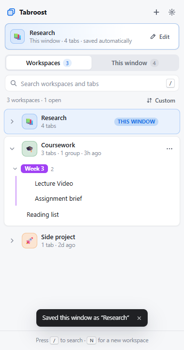
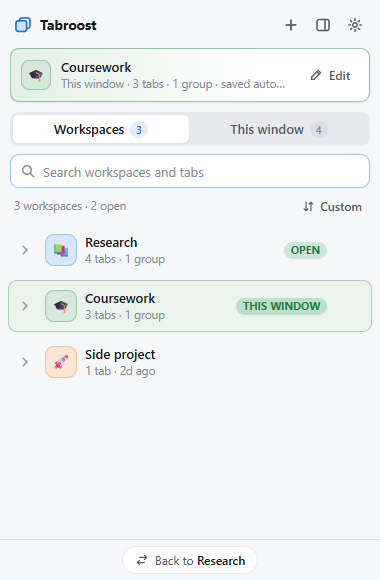
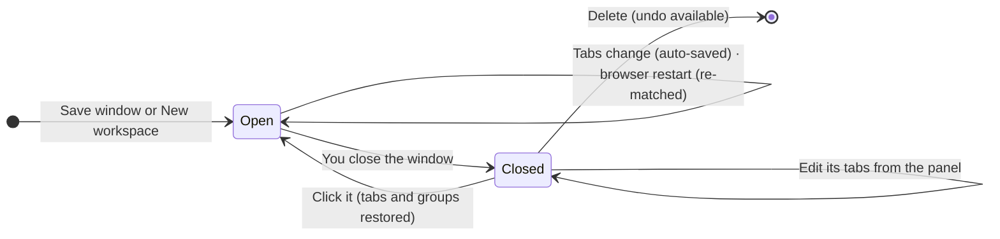
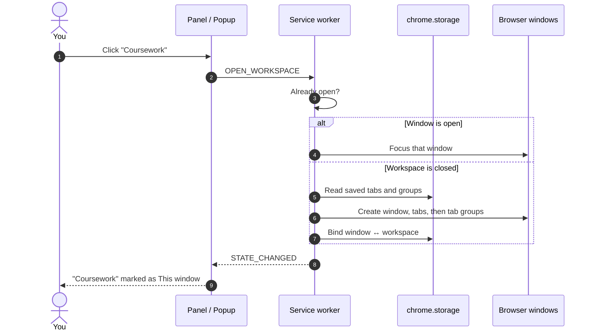
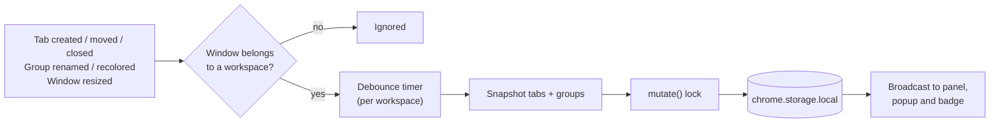
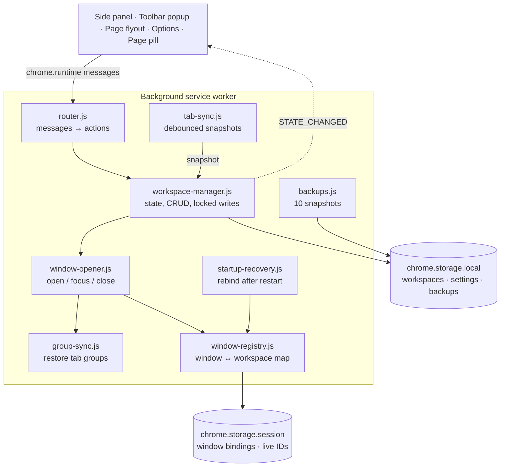
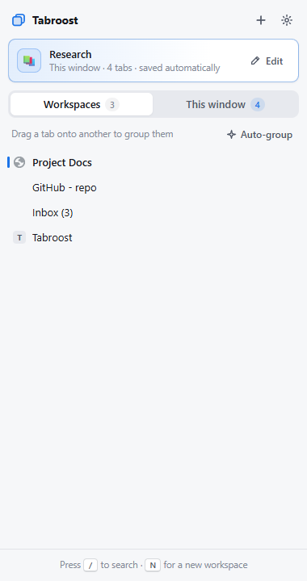
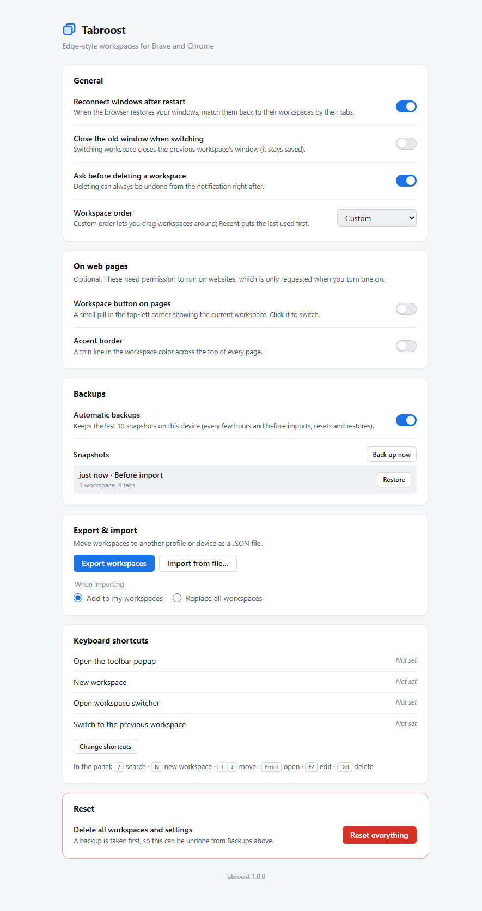

<div align="center">

# 🪺 Tabroost

**A home for every project's tabs.**
Edge-style workspaces for Brave and Chrome: one window per project, saved tabs and tab groups, instant switching.

[](https://github.com/Scrooge-777/tabroost/actions/workflows/ci.yml)


[](LICENSE)


&nbsp;


</div>

---

## Why Tabroost?

Too many tabs, all mixed together: school next to side projects next to shopping. Tabroost gives each project its own **workspace**, a named, colored window that remembers its tabs.

Close the window when you're done. Reopen the workspace next week and every tab, pinned tab, tab group (with its name, color and collapsed state) and the window size come back exactly as they were.

## Features

| | |
|---|---|
| 🪟 **One window per workspace** | Opening a workspace that's already open just focuses its window. |
| 💾 **Saves itself** | Tab and group changes are saved within half a second. Windows that aren't workspaces are never touched. |
| 🗂️ **Real tab groups** | Groups are saved and restored natively. Drag one tab onto another to group them; rename, recolor or pop tabs out. |
| 📂 **Edit closed workspaces** | Expand a workspace to see its tabs. Open, close, move or group them without opening the window. |
| ⚡ **Fast switching** | Toolbar popup, side panel, `Alt+Shift+W`, the "Back to …" chip, or a *previous workspace* shortcut. |
| 🔎 **Search** | Across workspace names, tab titles and URLs. |
| ♻️ **Never lose anything** | Undo delete, 10 automatic backups, and JSON export/import (merge or replace). |
| 🔁 **Survives restarts** | Restored windows are matched back to their workspaces by URL overlap. |
| 🎨 **Polished UI** | Light and dark themes, keyboard navigation, screen-reader labels. |
| 🏷️ **Optional page indicator** | A small pill and accent border on web pages. Off by default, and site access is asked for only when you turn it on. |

## Install

Tabroost isn't on the Chrome Web Store yet, so install it unpacked:

1. Clone the repo, or download the ZIP from GitHub and extract it:
   ```bash
   git clone https://github.com/Scrooge-777/tabroost.git
   ```
2. Open `brave://extensions` (or `chrome://extensions`).
3. Turn on **Developer mode**.
4. Click **Load unpacked** and select the folder that contains `manifest.json`.
5. Pin **Tabroost** to the toolbar.

To update later, run `git pull` and click the reload button on the extension's card.

## Quick start

1. Open some tabs for a project, then click the Tabroost icon and press **Save**. That window is now a workspace.
2. Give it a name, a color and an emoji.
3. Close the window whenever you like. It stays saved.
4. Click the workspace in the popup to bring it all back.

## How it works

### The life of a workspace

A workspace is always in one of two states: **open** (it has a live window) or **closed** (it lives only in storage).



### What happens when you switch



### How changes are saved

Every tab event in a workspace window starts a short timer. When things go quiet, the whole window is snapshotted once. All writes go through a single lock, so a background save and a click in the panel can never overwrite each other.



### Architecture



> 🧭 Prefer a whiteboard? [`docs/how-it-works.canvas`](docs/how-it-works.canvas) is the same map as a [JSON Canvas](https://jsoncanvas.org/) file. Open it in Obsidian or any JSON Canvas viewer.

**Key design points**

- **Two kinds of storage.** Workspaces live in `chrome.storage.local`, which survives restarts. Window bindings live in `chrome.storage.session`, which survives the service worker sleeping but is cleared when the browser exits.
- **Stable IDs.** Saved tabs and groups have their own string IDs. While a workspace is open, `window-registry` maps them to the live Chrome tab and group IDs. Panel actions go through that map, so clicking a tab in the panel focuses the real tab instead of opening a duplicate.
- **Restart recovery.** On startup, each restored window is compared with every workspace using Jaccard URL overlap. Pairs that overlap by at least 50% are re-bound, best match first.
- **Schema v2.** Version 1 data migrates automatically. Unknown settings are dropped, broken group references are cleaned up, and oversized inline favicons are removed.

## Using it

| Where | What |
|---|---|
| Toolbar icon | Popup switcher. Its panel button opens the side panel. |
| Window bar (top of panel) | Shows whether this window is a workspace. **Save** turns an unsaved window into one. |
| Workspace row | Click to switch. Use the chevron to show its tabs and `⋯` (or right-click) for actions. |
| *This window* tab | The current window's live tabs. Drag a tab onto another to group them, or use **Auto-group** to group by site type. |
| Page right-click | **Move tab to workspace**, **Save this window as a workspace**. |

<p align="center">
  
</p>

### Keyboard shortcuts

| Shortcut | Action |
|---|---|
| `Alt+Shift+W` | Open the workspace switcher |
| `Alt+Shift+N` | New workspace |
| *(unset)* | Switch to the previous workspace. Assign it at `brave://extensions/shortcuts`. |
| `/` | Search (in the panel) |
| `N` | New workspace (in the panel) |
| `↑` `↓` `Enter` | Move between workspaces and open one |
| `→` `←` | Show or hide a workspace's tabs |
| `F2` / `Del` | Edit or delete the focused workspace |

## Settings

<details>
<summary>Show the options page</summary>
<br>

</details>

- **Reconnect windows after restart** (on by default)
- **Close the old window when switching** (off by default)
- **Ask before deleting** (on by default, and delete can always be undone)
- **Workspace order:** custom (drag to reorder) or most recent first
- **On web pages:** workspace pill and accent border (both off by default)
- **Backups**, **export / import**, and **reset everything** (a backup is taken first)

## Privacy

- Everything stays in your browser's local extension storage. Nothing is sent anywhere, and there is no analytics.
- No website access by default. The optional page indicator asks for permission only when you turn it on, and turning it off removes it.
- Permissions used: `tabs`, `tabGroups`, `storage`, `unlimitedStorage`, `sidePanel`, `favicon`, `contextMenus`, `alarms`, `scripting`.

## Project layout

```
src/
├── background/       Service worker: router, workspace manager, tab sync, window opener,
│                     group sync, window registry, startup recovery, backups, badge, menus
├── content/          Optional page pill + accent border (shadow DOM)
├── sidepanel/        Panel, popup and flyout UI (one app, three modes) + components
├── options/          Settings page
└── shared/           Constants, schema and migration, colors, utilities
test/                 Unit tests (chrome.* mock) and real-browser smoke tests
docs/                 Screenshots and the how-it-works canvas
```

## Development

No build step. Edit the files, then click reload on the extension card.

```bash
npm test                 # import check + 43 logic tests against a chrome.* mock
npm run test:browser     # loads the extension in headless Brave via playwright-core
npm run test:page        # on-page pill + accent border in a real browser
```

The browser tests need `playwright-core` installed, or its path in `PLAYWRIGHT=<path>`. Set `BROWSER=<path>` to Brave or Chrome if it isn't in the default location. Screenshots go to a temp folder, or to the folder given as the first argument.

See [`test/manual-checklist.md`](test/manual-checklist.md) for the hands-on test pass.

## Contributing

Issues and pull requests are welcome. Please run `npm test` before opening a PR. CI runs it on every push.

## License

[MIT](LICENSE) © 2026 Scrooge-777
